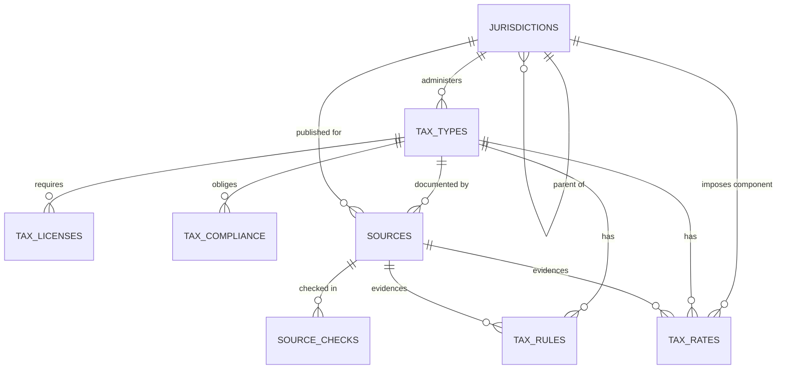

# Data Model — Phase 1

Containerized PostgreSQL 18 + pgvector, schema in Drizzle (`packages/database/src/schema.ts`). Texas is the example jurisdiction: all 27 levies from the [Texas Comptroller A-to-Z index](https://comptroller.texas.gov/taxes/a-to-z.php) are seeded, with deep detail for Sales and Use, Franchise, and Hotel Occupancy taxes.

## Entity map



## Tables

### `jurisdictions` — the whole world

Self-referencing hierarchy: `country → state | province | region → county → city → special_district`. Every tax fact hangs off a jurisdiction. `slug` is the stable machine key (`us`, `us-tx`, `us-tx-austin`); `code` holds an official code where one exists (ISO 3166, FIPS).

Overlapping special districts (one address inside several districts at once) are **not** forced into a single tree path. The tree records administrative parentage; which overlapping districts apply to a specific point is resolved at lookup time from `jurisdiction_geo` boundaries (M8).

### `jurisdiction_geo` — where jurisdictions are (M8)

One effective-dated row per published centroid or boundary: `centroid_lat/lng` + bbox as `numeric(9,6)` WGS84 (never float), `boundary_geojson` (Polygon/MultiPolygon, null for centroid-only), `geometry_hash` (sha256 of the canonical GeoJSON — the re-performance identity), recorded `simplification`, and `precision` (`published` | `approximate` where the legal line follows parcels/streets). Geo facts are facts: source-backed (`source_id` + citation with GIS vintage), proposal-gated, superseded never edited — a wrong boundary misstates the rate (GEO-PIP register, M8 milestone). Government GIS only (Census TIGER/Line, Texas GIS); districts with no published boundary are `confirmed_absent` in coverage, never hand-drawn. `reporting.current_geo` is the currently-effective view consumers read. PostGIS is the named upgrade when polygon count or query volume outgrows bbox + app-side point-in-polygon.

### `tax_types` — the hub

One row per levy **as administered** (e.g. "Texas Sales and Use Tax", administered by Texas). Two keys matter for agents and consumers:

- `slug` — stable ID, e.g. `us-tx-sales-use`.
- `category` — global comparable bucket (`sales_tax`, `vat_gst`, `franchise_margin`, `occupancy`, `excise`, `severance`, `gross_receipts`, `property`, `fee`, …). "Every sales tax on the planet" is `WHERE category = 'sales_tax'`.

### `tax_rates` — lookup for other services

One row per **imposing-jurisdiction component**. A combined rate is a sum of components — Texas sales tax in Austin:

| Component | Rate |
|---|---|
| State of Texas | 6.25% |
| City of Austin | 1.00% |
| CapMetro transit | 1.00% |
| **Combined** | **8.25%** |

`rate_value` + `rate_unit` handles every shape in one table: `percent` (stored as percent points — `6.25` means 6.25%), per-unit excise (`usd_per_gallon`, `usd_per_pack`), and flat fees (`usd_flat`). Every rate is effective-dated.

Lookup (components effective today for a place):

```sql
SELECT j.name, r.rate_value, r.rate_unit
FROM tax_rates r
JOIN tax_types tt ON tt.id = r.tax_type_id
JOIN jurisdictions j ON j.id = r.jurisdiction_id
WHERE tt.slug = 'us-tx-sales-use'
  AND j.slug IN ('us-tx', 'us-tx-austin', 'us-tx-capmetro')  -- applicable jurisdictions
  AND r.effective_from <= CURRENT_DATE
  AND (r.effective_to IS NULL OR r.effective_to >= CURRENT_DATE);
-- SUM(rate_value) over percent rows = combined rate
```

### `tax_rules` — everything that is not a rate

Typed by `rule_type`: `applicability`, `nexus`, `exemption`, `exclusion`, `threshold`, `calculation`, `sourcing`, `penalty`, `interest`, `discount`, `refund`, `definition`. Carries `authority_level` (statute / regulation / guidance / faq), citation, summary + full text, and an `embedding vector(1536)` column (pgvector) that Phase 2 agents populate for semantic search.

Texas proof: the 2% local cap / 8.25% max, franchise no-tax-due threshold ($2,650,000 for 2026–27), and penalty/interest rules are rules, not rates — they ride here.

### `tax_licenses` — operational permission to operate

Permits, licenses, registrations, and bonds required under a tax (e.g. the Texas Sales Tax Permit: who needs it, issuing agency, application URL, fee, renewal).

### `tax_compliance` — collect and remit

The operational half: `form_number/name/url`, `filing_frequency`, human `due_date_rule`, filing and payment channels, mandatory e-file thresholds, and `collect_remit_summary` — who collects from whom and remits to whom. This is what lets the platform answer "what do I file, when, and how do I pay", including split remittance (Texas local hotel taxes are remitted locally, not to the state).

`due_date_rule` starts human-readable; the machine form (e.g. `{day: 20, offsetMonths: 1, weekendShift: "next_business_day"}`) goes in `datavalues` until Phase 2 promotes a typed representation.

### `sources` + `source_checks` — the agent work queue

`sources` is every information source an agent must check and monitor: one row per URL / API / feed, with `source_type` (statute, regulation, agency_guidance, rate_table, form_library, faq, news_feed, api, dataset), publisher, `is_authoritative`, `monitor_cadence` (daily → manual), `check_method` (content_hash, http_etag, rss, api, manual), and last-checked / last-changed / content-hash state.

Phase 2 loop: select due sources (`status = 'active'` ordered by cadence + `last_checked_at`) → fetch → hash → append a `source_checks` row → on `changed = true`, extract proposed rate/rule updates for human review. `source_checks` is append-only: the monitoring audit trail is never rewritten.

Seeded today: 28 Texas sources — one official landing page per tax type, plus the A-to-Z index itself as the discovery source for new Texas levies.

## Cross-cutting conventions

- **Effective-dated, never overwritten.** Rates, rules, licenses, and compliance carry `effective_from` / `effective_to`. A change closes the old row and inserts a new one, so any past period can be answered as it stood then.
- **Source-backed.** Every fact row carries `source_id` + `citation` + `verification_status` (`unverified` → `verified` / `needs_review`). Seeded Austin local components and franchise table labels are deliberately left `unverified` / `needs_review` until a Phase 2 agent re-reads the labelled rate tables.
- **`datavalues jsonb`** on every domain table holds per-row extras (e.g. franchise deduction limits) without a migration. A key used by more than one query path gets promoted to a real column.
- **Free-text vocabularies, not DB enums**, for `category`, `rule_type`, `source_type`, etc. The world will produce values no enum anticipates; validation lives in the agent/app layer. Only `jurisdiction_level` and `verification_status` are enums — both are closed sets.
- **Money and rates are `numeric`**, never float.

## What Phase 1 deliberately does not model yet

- Street-address → lat/long geocoding. Lat/long is the input; point → applicable-jurisdictions resolution is modeled (`jurisdiction_geo`, M8). No vendor geocoder, ever.
- Treaties and cross-jurisdiction credits (e.g. withholding treaty rates). Add when the first non-US jurisdiction lands.
- Taxpayer accounts, returns, or payments. This platform stores tax law data, not taxpayer data.
- Change-proposal workflow tables (agent-proposed vs. approved facts). Phase 2 adds review state on top of `verification_status`.

## Run it

```powershell
docker compose up -d     # Postgres 18 + pgvector on localhost:5433
pnpm install
pnpm db:migrate
pnpm db:seed             # idempotent Texas seed
pnpm db:studio           # browse the data
```
